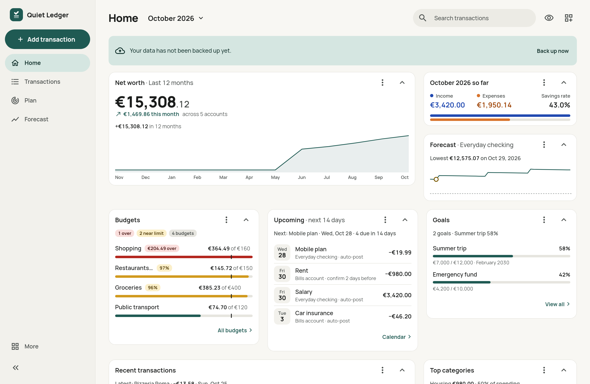
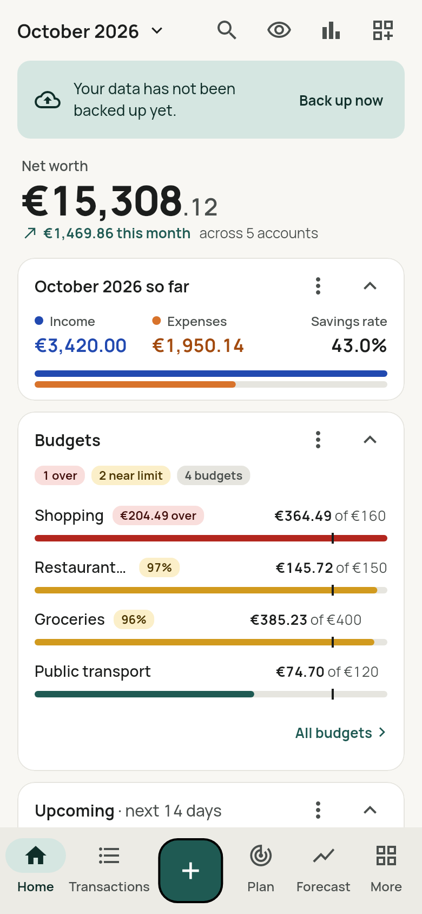
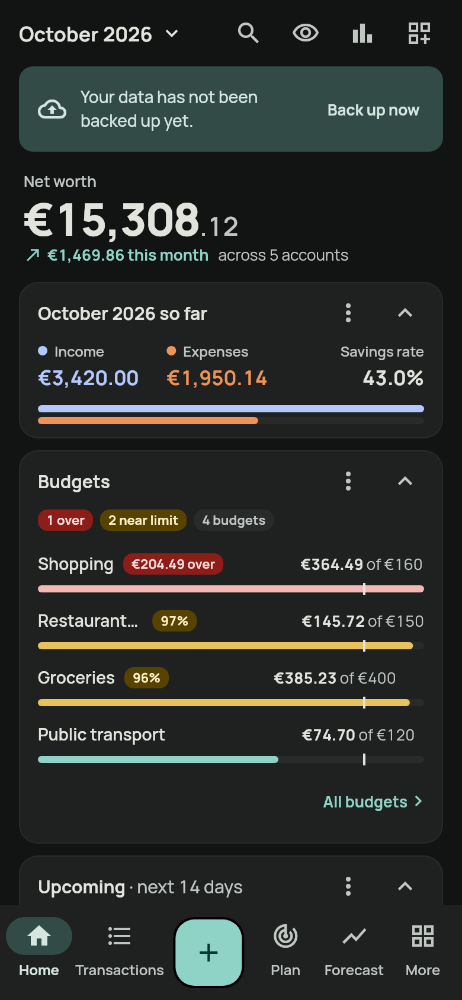
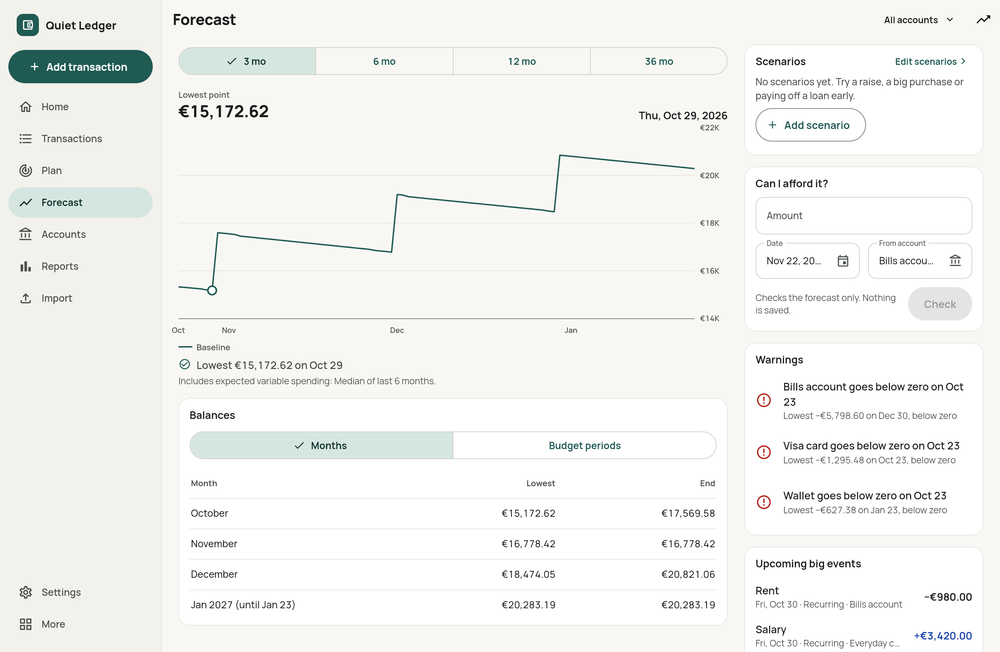
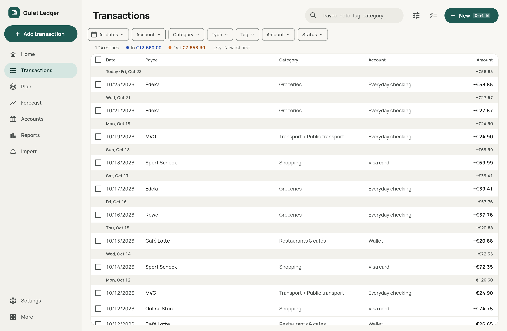

# Quiet Ledger

**A local-first personal finance app to record, track, plan and project your money.**

Quiet Ledger replaces the "every transaction in one Excel sheet" workflow with
a fast, private app that runs on Android, iOS, the web, Windows, macOS and
Linux. Your data stays on your device in an encrypted database: no account,
no telemetry, no cloud dependency.

[](../../actions/workflows/release.yml)
[](LICENSE)


<p align="center">
  
</p>

<p align="center">
  
  &nbsp;
  
</p>

> **Status:** pre-1.0 (`0.1.0`). The full v1 feature set is implemented, but
> data formats may still change before `1.0.0`. See
> [Known limitations](#known-limitations).

## Features

### Record
- **Quick add** in a few seconds: amount keypad with a built-in calculator
  (`12.50+3.20`), recent categories first, `Ctrl/Cmd+N` on desktop.
- Expenses, income and **transfers** (two linked legs, kept out of
  income/expense reports).
- **Split transactions**, tags, user-defined custom fields, templates and
  cleared / pending / planned status.
- **Auto-categorisation rules** (payee/note contains or matches a regex,
  amount range) that run on entry and on import.
- Transaction list with full-text search, filters, saved filters, bulk edit,
  swipe actions and undo.

### Track
- Checking, savings, cash, credit card, investment, loan and other
  asset/liability accounts, with balance reconciliation.
- A **configurable dashboard**: net worth, month summary and savings rate,
  budget progress, upcoming bills, mini forecast, goals and more.
- **Reports**: spending by category with drill-down, income vs expense, net
  worth over time, category trends, top payees, period comparison. Each one
  exports to CSV.

### Plan
- **Budgets** per category with rollover, tracking or envelope (zero-based)
  mode and warning thresholds. Budgets repeat (every period, every n-th,
  a number of periods or until a date), can have their own length (a
  week, month, quarter or year) and show planned and upcoming items as
  outstanding.
- **Flexible budget periods**: monthly, weekly, bi-weekly, quarterly or
  yearly; any start day; a salary-based start; weekend and public-holiday
  shifting.
- **Recurring bills and income** (iCal RRULE: "last business day", "every 3
  months on the 15th", ...) that are posted automatically or after you confirm
  them, with reminders and a bills calendar.
- **Savings goals**, showing the contribution needed per period and the
  projected completion date.

### Project
- **Cash-flow forecast** up to 36 months ahead at daily resolution, built
  from your balances, recurring items, expected variable spending and goal
  contributions. It shows the lowest point and warns before an account drops
  below zero or its threshold.
- **Net-worth projection** over 1–40 years with returns, loan interest and
  inflation (nominal or real).
- **What-if scenarios**: one-off events, raises, new or ended recurring
  items. Compare up to three against the baseline. A "Can I afford it?" check
  tests a purchase against the forecast.

<p align="center">
  
</p>

### Import, export & data
- **Excel and CSV import wizard**: `.xlsx`, `.xlsm`, `.xls`, `.csv`/`.tsv`
  and clipboard paste. It detects delimiters, encodings, header rows, date and
  number formats, debit/credit columns and subtotal rows. It also checks a
  running-balance column, detects transfers and duplicates, and supports
  re-usable import profiles and fully undoable import batches.
- **CSV export** of transactions and reports.
- **Backups that do not lose data** ([`docs/BACKUP.md`](docs/BACKUP.md)):
  - everything, receipt files included, in one verified file;
  - optionally encrypted with a backup password plus a recovery key (the
    app warns while backups are not encrypted);
  - scheduled to a folder (on Android, iOS and macOS also a cloud
    provider's folder) and read back after writing;
  - warnings when a backup fails or gets old;
  - automatic safety copies before restore, reset, import undo, merges and
    purges, restorable from the app;
  - a copy of the database before every schema migration.
  - Restore checks every byte, shows what changes, and can be undone.

### Privacy & personalisation
- Encrypted SQLite database (SQLite3MultipleCiphers) with the key in the OS
  secure storage; **app lock** with biometrics or PIN.
- Hide-amounts privacy mode; hide content in the app switcher.
- Light/dark/system theme, Material You dynamic colour, high contrast,
  configurable number and sign formats.
- English and German. Almost every behaviour is a setting, and Settings has
  a search.
- Adaptive layouts: a bottom bar on phones, a navigation rail and list-detail
  panes on tablets and desktops, plus keyboard shortcuts, hover states and
  context menus on desktop.

<p align="center">
  
</p>

## Tech stack

| Area | Choice |
|---|---|
| Framework | [Flutter](https://flutter.dev) 3.47 / Dart 3 |
| State | [Riverpod 3](https://riverpod.dev) (no code generation) |
| Database | [Drift](https://drift.simonbinder.eu) on SQLite3MultipleCiphers, FTS5 search |
| Routing | [go_router](https://pub.dev/packages/go_router) with a stateful shell |
| Charts | [fl_chart](https://pub.dev/packages/fl_chart) |
| Import | `excel_plus`, `csv`, `enough_convert` |
| Money math | `int` minor units + `Decimal` for rates, never `double` |
| Lints | `very_good_analysis` |

The data model and write path are **sync-ready**: every write goes through a
single `SyncWriter` that records hybrid logical clock timestamps and a change
log, so a sync backend can be added later without rewriting migrations.

## Getting started

### Prerequisites

- Flutter **3.47** (stable channel)
- Platform toolchains for the targets you want to build (Android SDK, Xcode,
  Visual Studio, ...)
- On Linux: `ninja-build`, `libgtk-3-dev` and `libsecret-1-dev`

### Run

```sh
flutter pub get
dart run tool/l10n.dart          # merge lib/l10n/parts/*.arb + gen-l10n
dart run build_runner build      # generate Drift code
flutter run -d linux             # or: chrome, android, windows, macos, ios
```

On the web, the database runs in a custom Drift worker in `web/`. Rebuild it
with `tool/build_web_worker.sh` after upgrading Drift.

### Check

```sh
dart format --output=none --set-exit-if-changed lib test tool
dart run tool/l10n.dart --check      # fails on missing German strings
dart run tool/version.dart --check   # app_version.dart + CHANGELOG in sync
dart analyze
flutter test                         # unit, DB, widget and app-flow tests
flutter test tool/screenshots/screenshots_test.dart   # PNGs in build/screenshots
```

CI ([`.github/workflows/ci.yml`](.github/workflows/ci.yml)) runs these checks
only for version tags, as the first step of the release (see
[Versioning](#versioning)); pushes and pull requests are not checked.

## Project layout

| Path | Contents |
|---|---|
| `lib/core/` | Money, Drift schema + `SyncWriter` (HLC + change log), settings catalogue, ledger repository, recurrence/holidays/budget periods, CSV |
| `lib/app/` | Bootstrap, router, adaptive shell, theme tokens, shared widgets |
| `lib/features/` | accounts, categories, transactions, rules, import, export, budgets, recurring, goals, plan, forecast, scenarios, reports, dashboard, settings, security, onboarding |
| `lib/l10n/parts/` | Per-feature EN/DE strings, merged by `tool/l10n.dart` |
| `test/` | Mirrors `lib/`; Excel/CSV fixtures in `test/fixtures/import/` |
| `tool/` | l10n merge, version bump, fixture and screenshot generators |
| `docs/` | Architecture, versioning policy, design draft |

## Documentation

- [`PLAN.md`](PLAN.md): product plan and full feature scope
- [`docs/ARCHITECTURE.md`](docs/ARCHITECTURE.md): code conventions (read
  before contributing)
- [`docs/BACKUP.md`](docs/BACKUP.md): backup format, encryption, safety
  copies and the data-safety rules
- [`docs/VERSIONING.md`](docs/VERSIONING.md): versioning policy and release
  steps
- [`docs/design/`](docs/design/): the "Quiet Ledger" design draft, one file
  per screen
- [`CHANGELOG.md`](CHANGELOG.md): release notes

## Versioning

Semantic versioning (`MAJOR.MINOR.PATCH+BUILD`) from `version:` in
`pubspec.yaml`. Because an app has no code API, the "public API" is the
user's data: a backup-format change is a major release, a database schema
migration at least a minor one.

```sh
dart run tool/version.dart bump minor   # major | minor | patch | build
git commit -am "Release X.Y.Z" && git push
git tag -a vX.Y.Z -m vX.Y.Z && git push origin vX.Y.Z
```

The tag push runs CI and publishes a GitHub release with Android, Linux,
Windows, macOS and web builds; platforms are selectable (see
[`docs/VERSIONING.md`](docs/VERSIONING.md#releasing)).

## Known limitations

- Web database encryption is implemented but not yet verified in a real
  browser; the web key is only as safe as the browser profile.
- The Android backup-folder channel compiles but still needs testing on
  devices with local and cloud folders; the iOS and macOS folder channels
  have not been compiled yet.
- Backups are built in memory; very large receipt collections need that much
  free memory.
- Linux cannot schedule notifications (plugin limitation); immediate alerts
  work.
- iOS, macOS and Windows builds have only been compiled in CI so far.
- Not in v1 (per plan): sync backend, bank connections, multi-currency (EUR
  only), xlsx export, Sankey charts, forecast uncertainty band, `.ods` /
  `.numbers` import.

## Contributing

Read [`docs/ARCHITECTURE.md`](docs/ARCHITECTURE.md) first. In short: amounts
are `int` cents, all writes go through `SyncWriter`/`LedgerRepository`, no
hard-coded strings (add both EN and DE), and `dart format` plus
`dart analyze` must be clean. Note user-visible changes under "Unreleased" in
[`CHANGELOG.md`](CHANGELOG.md).

## License

Quiet Ledger is free software: you can redistribute it and/or modify it
under the terms of the [GNU General Public License](LICENSE) as published by
the Free Software Foundation, either version 3 of the License, or (at your
option) any later version.

It is distributed in the hope that it will be useful, but **without any
warranty**; without even the implied warranty of merchantability or fitness
for a particular purpose. See [`LICENSE`](LICENSE) for details.

Bundled fonts (Manrope, IBM Plex Mono) are licensed under the SIL Open Font
License; see `assets/fonts/`.
